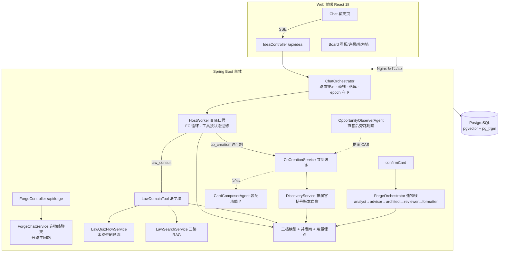

# 点子铺 架构文档

> 定位：仙官「百晓仙君」坐镇的创意收集智能体——朋友聊出来的点子炼成功能卡，好点子被真的做出来；内嵌法学助手（法律咨询 + 法考备考刷题）。
> 形态：单体仓库 = Java 后端 + Web 前端 + 部署脚本（小程序端已放弃保留壳）。
> 更新时间：2026-10-30（共创许可制 + 推演自愈 + 造物线 Forge 上线后，全文以当前代码为准重写）

---

## 1. 系统概览

| 维度 | 说明 |
|---|---|
| 后端 | Java 17 + Spring Boot 3.4.1，jar 包 + systemd 部署于云服务器 |
| 前端 | React 18 + Vite 6，白灰简约风，手机/PC 自适应，无路由库（App.jsx state 切视图） |
| 数据库 | PostgreSQL（pgvector + pg_trgm 扩展），JPA ddl-auto=update 管理 |
| LLM | 智谱 GLM 系列：langchain4j 双客户端（zhipu 社区模块 + OpenAI 兼容端点），三档模型分工 |
| 编排 | Host Orchestrator 模式：百晓仙君为唯一前台 agent，经 function calling 调度领域工具 |
| 部署 | 推送 main 触发 GitHub Actions 构建 → scp → systemd 重启；Nginx 反代 `/api` |
| 观测 | llm_usage_log 埋点 + Prometheus 指标（9913 管理端口）+ traceId 全采样日志 |

---

## 2. 总体架构



三条主链路：**创意访谈**（聊天 → 共创推演 → 功能卡 → 造物线施工包）、**法学域**（RAG 问答 + 刷题判分）、**辅助能力**（许愿池 / PRD 车间 / 每日一签 / 感谢卡）。

---

## 3. 后端架构

### 3.1 包结构

```
com.mengx.server
├── auth / user   # 登录即注册 + JWT 签发/校验，用户实体（手机号+密码 BCrypt）
├── idea          # 核心业务域
│   ├── orchestrator      # ChatOrchestrator / ContextManager / FrameStackManager / DomainTool / SchemaValidator
│   │   └── worker        # HostWorker（FC 循环）+ CoCreationDomainTool / LawDomainTool
│   ├── agent             # 推演官/观察器/装配器/许愿双官/PRD 格式化官/感谢官（IdeaAgentFactory 装配）
│   └── (服务层)           # 会话/卡片/提案/推演/刷题流/PRD/许愿/感谢 各 Service
├── law           # 法学域：三路 RAG / 导入管道 / 出题官 / 判卷官 / 学情画像
├── forge         # 造物线：岗链编排 / 黑板 / 工部线程池 / 传话人 / 断点恢复
├── llm           # 并发闸 ConcurrencyGuardedStreamingModel + 用量埋点三件套
├── routing       # ChannelRegistry / ChannelSpec / WorkerType（通道注册表）
├── features      # 每日一签（FortuneDeck 卡池 + 当日幂等抽取）
├── config        # AiModelConfig 三档模型 / SecurityConfig / ObservabilityConfig
└── controller    # 健康检查
```

### 3.2 入口与安全

- **登录即注册**：`POST /api/auth/login` 手机号存在验密码、不存在自动建号（昵称=点友+尾4位）。无独立注册，无访客链路。JWT TTL 7 天。
- **JWT 过滤链**：JwtAuthFilter 逐请求校验；SecurityConfig 放行 `/api/auth/login`、`/api/health`，并显式放行 ASYNC/ERROR 派发类型（Spring Security 6.4 默认鉴权所有派发类型，不放行 SSE 异步收尾会误报 Access Denied）。
- **归属校验**：idea 域全部接口 JWT 绑 userId；会话/卡片操作校验本人；看板与创意榜全员可见（信任圈产品）。

### 3.3 LLM 基础设施（AiModelConfig + llm 包）

**三档模型**（`ai.model.*` 配置，密钥全部环境变量注入不入库）：

| 档位 | Bean | 模型 | 参数 | 用途 | 客户端 |
|---|---|---|---|---|---|
| host 流式档 | streamingChatModel | glm-5.3-flash | temp 0.7 / 4096 tokens / reasoning_effort low | Host FC 路由与直答、法学助手、共创领域顾问 | OpenAI 兼容端点 |
| agent 同步档 | chatModel | glm-5.3-flash | temp 0.2 / 8192 tokens / reasoning_effort low | 推演官/观察器/装配器/PRD 格式化官/出题官/判卷官等结构化 agent | OpenAI 兼容端点 |
| route 轻量档 | routeChatModel | glm-4-flash | temp 0.1 / 256 tokens / thinking disabled | 二分类（传话人形态路由等） | zhipu 社区客户端 |

- **为什么双客户端**：host/agent 档为强制思考模型，`reasoning_effort` 只有 OpenAI 兼容端点能传（zhipu 社区模块不支持）；思考 token 计入 completion，max-tokens 留足防截断。
- **为什么 host 用 5.3-flash**：glm-4-flash 免费档实测无视注入的路由指令（session 153 同 payload 四连逃逸直答），5.3-flash 重放四连服从。
- **并发闸**（ConcurrencyGuardedStreamingModel）：semaphore 15 路（留 5 路给 route 档与重试），流式请求自发出至流结束全程占一路，超出排队（acquire timeout 60s）——多用户高峰下排队优于直接 429 空回复；配合 1302 限流 2 秒退避重试。
- **用量埋点**：`LlmUsage`（ThreadLocal scene）→ `ZhipuUsageListener`（onRequest 计时 / onResponse 归一上报）→ `LlmUsageRecorder` 双写 `llm_usage_log` 表 + Micrometer 指标；观测失败不影响主流程。

### 3.4 会话编排核心（Host 模式）

用户全程只感知百晓仙君一个前台 agent；领域 agent 全部隐身幕后，输出不经 Host 二次包装直达用户。

```
IdeaController POST /api/idea/chat/stream（SseEmitter 手动桥接 Flux，逐 token flush）
  → IdeaChatService.stream（clientRoundId 一轮幂等键，同键重发只落库一次）
    → ChatOrchestrator
        · ContextManager：从 idea_messages 服务端真源组装上下文（Host 全通道最近 40 条 + 当前输入）
        · routeHint：显式 mode（前端许可提案后以 mode=cocreation 发首轮）或 interviewHot
          时向 Host 系统提示注入指令化路由指令（措辞与重放验证 payload 逐字一致）
        → HostWorker.stream：系统提示 + 历史 + tool specs → streamingChatModel FC 循环
            ├─ 直答：token 流式下发
            └─ onCompleteToolCall：调领域工具，领域输出流式直达用户
        · 落库（producer_channel 分帧标记）+ FrameStackManager 帧栈切换
```

- **DomainTool 接口**：`name/channel/description/parametersSchema/availableFor(session)/invoke`。`availableFor` 是**许可制硬控点**——工具对 Host 的可见性由会话状态决定，冷启动物理排除（不进 FC 工具列表），而非概率服从。
- **帧栈隔离**（FrameStackManager）：多通道切换时挂起/恢复旧帧，历史按 `producer_channel` 分帧隔离（法学上下文只取 law 通道最近 40 条）；帧栈持久化在会话行。
- **epoch 守卫**（DiscoveryEpochGuard）：每轮用户消息递增 epoch，作废跨轮异步结论——防止营造图回退或误关发现模式。

**SSE 事件协议**（前端 streamIdeaChat 消费）：`thinking`（推演过程提示）/ `chunk`（正文 token）/ `card`（卡片 DTO）/ `citations`（法学引用）/ `design`（营造图 JSON）/ `done` / `error`。

### 3.5 共创访谈域（idea 包核心）

**入口许可制**（冷启动直调 co_creation 属流程违例，被 availableFor 物理排除）：

```
Host 直答 → OpportunityObserverAgent 旁路观察（直答结束后异步，不阻塞对话）
  → 判定 PROPOSE → IdeaProposalEntity 落库（PENDING，supersede 旧待决提案；
      前置校验：本场卡片数<5、标题非空、访谈未进行、热窗未触发）
  → 前端轮询 notices（8s 间隔/30s 超时/收到即停）出邀请卡
  → 用户点「聊聊看」→ CAS PENDING→ACCEPTED（dismiss 则 PENDING→DISMISSED）
  → 前端以 mode=cocreation 发首轮（路由三态最强提示）→ Host 调 co_creation 进共创
  → 热窗内（interviewHot）路由指令自动延续，直至定稿
```

- **licensedToEnter**（CoCreationService）：`interviewHot`（最新推演未定稿且距此刻 < 1800s）或存在未消化的 ACCEPTED 提案——`co_creation` 工具仅此时对 Host 可见。
- **访谈轮内**（handleInterview）：推演背景组装（含 undigestedProposalContext：已许可提案四要素注入）→ DiscoveryService.composeAndArchive 同步推演并存档 → `design` 事件直发前端营造图面板 → 顾问（host 档）流式回复（推演结论经 renderForHost 简报注入，以顾问自己的口吻转述——推演官不发言不露面）→ closingConfirmed 后异步装配功能卡（CardComposerAgent，SSE card 事件）。
- **推演官**（DiscoveryService + CoCreationAgent）：一次调用同时维护规格快照（核心三要素 + 动态维度，随轮累积演进）与本轮议程（聚焦/问法/选项/方案/合理性判定/收口信号/关键项）。上一版快照回灌，模型异常与输出不完整均 2 秒退避重试一次。
- **解析自愈**（parseTurn）：glm-5.3-flash 生成长嵌套 JSON 偶发尾部闭合括号错乱（finish=stop 但根对象未闭合，非截断）。三档纵深防御：① compose 失败路径 WARN 留痕原始输出；② 括号账本自愈 repairBrackets（字符串感知走查：串尾错型闭合符替换为栈顶期望闭合符、EOF 栈非空按 LIFO 补齐、中段错乱拒绝）+ keyItems 塌陷上提 + 语义自检（snapshot 非空、原文含 keyItems 字面量时解析结果必须非空），自愈不过落回重试；③ prompt 输出纪律段要求逐层闭合、以单个 `}` 收尾。

### 3.6 法学域（law 包 + LawDomainTool + LawQuizFlowService）

Host 调 `law_consult` 后法学域接管整轮，两条路径：

1. **刷题子流程**（LawQuizFlowService，域内零模型意图判定——触发词/正则命中即接管）：
   - 出题：客观题逐题生成（单选→多选→不定项轮换，考点防重复，学情加权）+ 主观题独立成组（案例分析+采分点，采分点不下发防泄题）；「继续出」强意图直达。
   - 交卷：客观题纯代码字母比对判分（零模型）→ 汇总讲评；主观题判卷官（LawJudgeAgent）逐采分点 hit/partial/miss 批改，得分率≥60 及格落库。
   - 学情：画像触发词命中即纯代码聚合汇报。
2. **法条 RAG 问答**：三路融合检索（编号正则精确匹配置顶 → 向量召回 qwen3.7-text-embedding-flash 1024 维 → pg_trgm word_similarity 字面补充），RRF 融合，任一路失败自动降级；备考意图（真题/刷题/考点等信号词）才补检真题，日常咨询只查法条；引用随 `citations` 事件下发；免责声明随正文流式下发并落库。

- **导入管道**（LawImportService + LawImportController）：law_articles（法条+司法解释）/ law_questions（2002-2024 真题）/ law_notes（教材）三类表，content_hash 幂等锚点，16 条/批限速向量化，后台线程 + 内存进度。
- **学情画像**（LawProfileService）：不建表，law_answer_records 实时聚合；弱点=题量≥2 且错误率≥50%；三消费点：出题加权（quizBriefing）/ 问答口吻（chatHint）/ 学情汇报（report）。

### 3.7 造物线 Forge（forge 包，功能卡 → 施工包）

**产品链路**：功能卡确认（新芽→已确认）事务内自动创建 ForgeJob 工单 → 工部岗链流水线加工 → 终审 → 排版官输出施工包 Markdown 写回卡片（DONE）→ 可下载直接投喂 AI 编程工具。与主回路物理隔离（`/api/forge/**` 独立路径，旁路路由器/法学检索/推演/观察全套）。

```
岗链：analyst（需求分析·产品深化段）
    → advisor（领域顾问·插拔槽位：AdvisorRegistry 按 domainSignals 匹配
        工单文本选 LegalAdvisor / DefaultAdvisor，未命中走默认）
    → architect（架构设计段）→ reviewer（审校）
        └─ 四态指令状态机：WAIT（挂起等用户）/ BLOCK / REWRITE（打回指定岗，硬上限 2 轮）/ CONTINUE
    → 终审 REVIEW → formatter 排版官 → 施工包 Markdown → 卡片 DONE
```

- **黑板模式**（ForgeBlackboard）：各岗只写本岗段（product / openQuestions / domainDesign / …），`settle`「先落盘后交棒」原子更新工单的 stagePayload / pendingQuestions / 状态 / 当前岗 / 轮次。
- **工部执行宿主**（ForgeExecutor）：独立线程池 core/max=2/4（单工单串行，压并发是 1302 限流的既有教训），有界队列 200 + CallerRuns（任务绝不丢），岗任务 10 分钟看门狗超时。执行纪律：线程池里零等待——「等人」只存在于数据库行（WAITING_* 状态零线程占用）。
- **传话人**（ForgeHeraldService）：仙官分身与客人之间的唯一传话人，只做形态路由不做内容理解（route 档三分类 answer/demand/chat）；挂起问题按分身口吻转述（信封 type=notice/question/reply 落 idea_messages；backlog 不渲染仅供审计）。用户看不到星君/黑板/JSON。
- **造物线聊天**（ForgeChatService）：`POST /api/forge/jobs/{jobId}/chat/stream` 一问一答一关流；resume 在工部线程池后台跑，新挂起问题以分身消息落库、前端轮询可见；casResume 条件 UPDATE 防重入（答案到达/手动重试/开机恢复三种触发源竞争安全）。
- **断点恢复**（ForgeRecoveryHook）：开机一次性扫描 RUNNING 超 30 分钟残留工单，从 stage 断点重跑（岗任务幂等：只认黑板输入重写本岗段）。
- **施工手册**（ForgeHandbookStack + classpath:forge-handbook.md）：技术栈与既有能力基线的真源（STACK 标记段），PRD 车间同源复用。

### 3.8 辅助产品能力

| 能力 | 服务 | 流程 |
|---|---|---|
| 许愿池 | IdeaWishService | 一句话愿望 → 提炼官（WishDistiller 四要素初稿）→ 追问官（WishRefiner 打磨成完整功能卡）接力，同步 20~60s，炼成新芽卡并自动开一场记录；货架 30 条内防重复比对，相似不拦截 |
| PRD 车间 | IdeaPrdService | 已确认卡一键格式化（PrdFormatterAgent，异步）：功能卡 + 设计沉淀 → 施工 PRD / 应用蓝图 Markdown 存 prdJson 可下载；单工序不新增设计 |
| 感谢卡 | IdeaThanksService | 点子标记「已实现」后异步（ThanksAgent）仙君亲写答谢卡，一张卡只递一次，进聊天页弹层 |
| 每日一签 | FortuneService | FortuneDeck 卡池 + 当日幂等抽取（idea_fortune_draws） |
| 卡片看板 | IdeaService | 状态机 SPROUT（新芽）→ CONFIRMED（已确认=授权开工，事务内自动建造物线工单）→ IMPLEMENTED（已实现）；看板/创意榜 TOP10/我的点子墙/Markdown 导出 |

### 3.9 REST/SSE 端点清单（全部 JWT 鉴权，除登录与健康检查）

| 前缀 | 端点 |
|---|---|
| `/api/auth` | `POST /login` 登录即注册 |
| `/api/idea` | `POST /sessions` 开场；`POST /chat/stream` 主对话 SSE；`GET /sessions`、`GET /sessions/{id}/messages|cards|design|notices`、`DELETE /sessions/{id}`；`POST /proposals/{id}/accept|dismiss` 提案裁决；`GET /cards`、`GET /my-cards`、`GET /leaderboard`、`POST /cards/{id}/like|confirm|prd`、`DELETE /cards/{id}`、`PATCH /cards/{id}/status`、`GET /cards/{id}/prd|build` PRD/施工包下载；`GET /thanks/unread`、`POST /thanks/{id}/read`；`POST /wish`；`GET /export` |
| `/api/forge` | `GET /jobs`、`GET /jobs/{id}`、`GET /jobs/{id}/messages`、`POST /jobs/{id}/chat/stream`（SSE）、`POST /jobs/{id}/review`、`POST /jobs/{id}/retry` |
| law 导入 | LawImportController（profile 触发，三类数据管道） |
| `/api/health` | 健康检查（免鉴权） |

---

## 4. 数据模型

```mermaid
erDiagram
    users ||--o{ idea_sessions : "userId"
    idea_sessions ||--o{ idea_messages : "sessionId"
    idea_sessions ||--o{ idea_cards : "sessionId"
    idea_sessions ||--o{ idea_proposals : "sessionId"
    idea_cards ||--o{ forge_jobs : "cardId 确认即开工"
    idea_cards ||--o{ idea_likes : "cardId"
    idea_cards ||--o{ idea_thanks : "cardId 一卡一封"
    users ||--o{ law_answer_records : "userId"
    law_questions ||--o{ law_answer_records : "questionId"
    users ||--o{ idea_fortune_draws : "userId 当日幂等"

    idea_sessions {
        jsonb frame_stack "帧栈（通道挂起/恢复）"
    }
    idea_messages {
        string role "user/assistant/counsel推演存档/backlog造物线审计"
        string producer_channel "host/law/cocreation 分帧隔离"
    }
    idea_cards {
        string status "SPROUT→CONFIRMED→IMPLEMENTED"
        jsonb design "营造图快照"
        text prd_json "PRD/施工包 Markdown"
    }
    idea_proposals {
        string status "PENDING→ACCEPTED/DISMISSED（CAS）"
    }
    forge_jobs {
        string status "RUNNING/WAITING_*/REVIEW/DONE/FAILED"
        string stage "当前岗 analyst/advisor/architect/reviewer"
        jsonb stage_payload "黑板各岗段"
        jsonb pending_questions "挂起等用户的问题"
        int rounds "审校打回轮次（≤2）"
    }
    law_articles ||.. law_questions : "embedding vector(1024)"
    llm_usage_log {
        string scene "chat/counsel/route/quiz_gen/grade/forge..."
        string status "ok/rate_limited/error"
    }
```

---

## 5. 前端架构（web/，React 18 + Vite 6）

- **视图**：App.jsx state 切换 Login → Chat（主界面）/ Board（看板），无路由库；消息列 820px 居中窄栏，移动端输入 16px 防 iOS 聚焦缩放。
- **API 客户端**（api.js）：统一封装自动携带 `Authorization: Bearer`（localStorage `mengx_token`）；SSE 用 fetch + ReadableStream 手写解析（按空行分隔事件、多行 `data:` 拼接后 JSON.parse），非 2xx 抛后端 message。
- **营造图面板**：消费 `design` 事件（推演存档 JSON），解析核心三要素/动态维度/待处理项/选项，待聊格子置灰、新更新带标记；历史场次经 `GET /sessions/{id}/design` 恢复。
- **提案轮询**：对话间隙轮询 notices（8s/30s/收到即停），邀请卡出「聊聊看/暂不」按钮；许可后自动以 mode=cocreation 发首轮。
- **试卷模式**：题卡逐张到达即可作答（客观点选 toggle 暂存/主观 textarea），交卷按钮批量提交；「继续出」仅嵌在最后一条讲评内。
- **会话恢复**：消息从后端拉取（换设备不丢），localStorage 只存当前场指针与登录回填。

---

## 6. 可观测性

| 层 | 实现 |
|---|---|
| 用量埋点 | LlmUsage（ThreadLocal scene）→ ZhipuUsageListener 单点上报 → LlmUsageRecorder 双写 llm_usage_log + Micrometer；scene 覆盖 chat/counsel/route/quiz_gen/grade/forge 等 |
| Metrics | actuator + prometheus registry，管理端口 9913 仅绑 127.0.0.1（Nginx 只转发 /api，公网不可达）；llm_calls_total / llm_latency_seconds / llm_tokens_total + rag/embedding 指标 |
| Tracing | micrometer-tracing-bridge-brave，全采样，traceId/spanId 随每行日志输出；context-propagation 保证 SSE 切后台线程不丢——grep 一个 traceId 串起路由→检索→推演→炼卡全链路 |
| 查账 | `SELECT scene,sum(completion_tokens) FROM llm_usage_log WHERE created_at>now()-interval '7 days' GROUP BY scene` |

---

## 7. 部署架构

```
GitHub push main ──► Actions: mvn package + npm build ──► scp ──► systemd 重启
浏览器 ──► Nginx(80/443) ──/api 反代──► Spring Boot(8080) ──► PostgreSQL(pgvector)
                                    └─ / 静态托管 ──► web/dist
SSE 关键配置：proxy_buffering off + 响应头 X-Accel-Buffering: no（禁用缓冲防打字机变一次性输出）
```

- 后端 systemd 单元 `deploy/meng-x.service`：`java -jar` 启动，失败自动重启，`/opt/meng-x/meng-x.env` 注入全部敏感配置（DB 密码 / JWT secret / LLM 与 embedding key / 法学数据目录）。
- 敏感配置三层不入库：`application-local.yml`（本地，gitignore，spring.config.import 自动加载）/ 服务器 env / 环境变量默认值兜底。

---

## 8. 工程实践：重放诊断体系（replay-test/）

路由与工具调用纪律不靠感觉，靠重放实证：`replay-test.ps1 -Scenario hot|licensed` 以真实历史 payload 直调 BigModel API，验证模型在关键场景的行为（如 5.3-flash 对注入路由指令的四连服从、许可后首轮一跳进共创）。配套 jackson-repro*.jsh 系列 jshell 实验脚本（推演 JSON 尾部塌陷根因诊断、自愈算法回归），中毒样本 `counsel-run2-clean.txt` 留作修复回归资产。**改模型名或路由措辞后重跑即可做纪律回归。**

---

## 9. 关键设计决策（速查）

1. **Host FC 编排而非服务端强制路由**：路由权归 Host function calling（V2 定案）；曾实施的 V3 服务端强制路由 + 闸门二分类已删除。路由指令措辞与重放验证 payload 逐字一致，防措辞漂移引发逃逸。
2. **许可制硬控（availableFor）**：工具可见性由会话状态物理排除（冷启动不进 FC 列表），而非靠提示词概率服从；工具描述收窄作第二道防线。
3. **host/agent 档走 OpenAI 兼容端点**：reasoning_effort 只有该端点能传（GLM-5.3 系强制思考必需降档）；思考 token 计入 completion，max-tokens 留足。
4. **流式并发闸**：15 路 semaphore 全程占用 + 排队优先于 429；造物线工部独立线程池 2/4 串行——两处压并发均出自 1302 限流教训。
5. **SSE 手动桥接**：不用 ReactiveTypeHandler 内置桥（单槽+每元素线程调度接力，token 攒到收口才涌出）；直接订阅 Flux 在生成线程逐个 send+flush。
6. **分帧隔离**：历史按 producer_channel 分帧（法学 40 条窗口），多领域并行不串味；帧栈持久化支持挂起恢复。
7. **epoch 守卫**：每轮递增，作废跨轮异步结论（观察器晚到、营造图回退）。
8. **推演解析三档纵深**：留痕（失败路径存原始输出）→ 括号账本自愈（只救尾部，中段错乱拒绝；keyItems 塌陷上提防 FAIL_ON_UNKNOWN_PROPERTIES 静默吞字段；语义自检不过落回重试）→ prompt 闭合纪律。
9. **造物线「等人」只在数据库行**：WAITING_* 状态零线程占用；岗任务幂等（只认黑板输入重写本岗段）支撑断点重试与开机恢复；casResume 条件更新防多触发源重入。
10. **确定性优先，模型兜底**：刷题子意图/学情/出题触发词全部零模型判定；客观题判分纯代码；只有灰区才动 route 档。
11. **幂等键遍布**：clientRoundId 一轮一落库、提案 CAS 状态机、导入 content_hash、每日一签当日幂等、感谢卡一卡一封。
12. **画像不建表**：law_answer_records 实时聚合，零漂移，三消费点（出题/口吻/汇报）同源。
